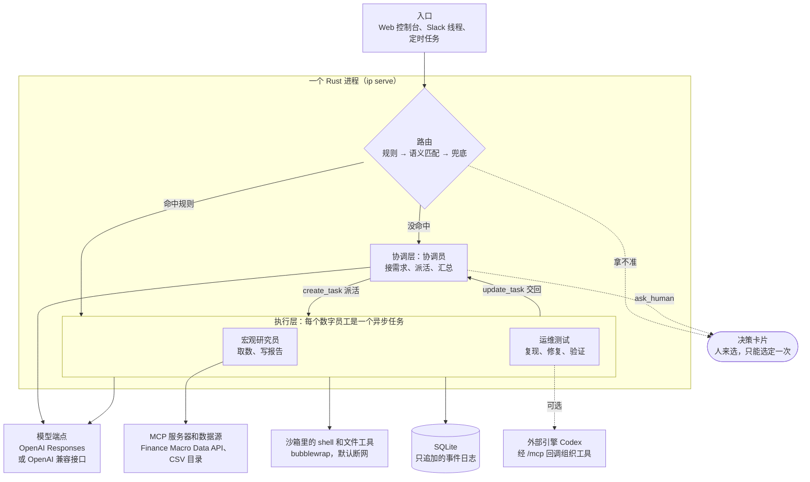

# intelligent-position（I.P.）

一套开源的“AI 原生组织架构”：把公司里的岗位做成由数字员工承担的单元，人只在关键节点拍板。
运行底座是一个 Rust 进程，跑在一台云 Linux 主机上，每个数字员工是进程里的一个异步任务。

> 项目还在开发中，没有正式发布。下面“现在到哪一步”写的是真实状态：哪些用真实模型跑通过，哪些只用假服务测过。

## 这是什么

- **协调和执行分两层。** 协调员用云端最强的模型，只负责接需求、派活、汇总；执行员工用便宜的模型取数、写报告、干活。执行层以后换成岗位专家小模型，只需换一个端点。
- **路由先给方案，人来改。** 一条需求先按人写的规则分派，规则没命中再请模型判断，拿不准就发一张决策卡片给人选。人改派过的决定生成规则草案，人批准后才生效。
- **员工是任务，不是进程。** 空闲的数字员工只占几十 KB 以内的内存，一台 4 核主机上常驻几百个。性能算功能的一部分，启动、内存、并发都有基准。
- **权限集中在一个配置文件。** 岗位、员工、模型、数据源、MCP 服务器、预算都写在 `ip.yaml` 里。shell 命令跑在 bubblewrap 沙箱里，默认断网；密钥只放环境变量。
- **现在只用一个岗位做展示。** 宏观研报岗位：取宏观数据，写带来源和观测日期的研究报告。第二个岗位是运维测试。

## 现在到哪一步

| 部分 | 状态 |
| --- | --- |
| 宏观研报岗位：协调员派活 → 研究员取数写报告 → 交回 → 汇总 | 用真实模型和真实数据跑通过一次（2026-11-11，美国数据），见[验收记录](docs/ip/acceptance-2026-11-11.md) |
| 质量评测 `ip eval` | 两个固定问题的冒烟测试，用真实模型跑过多遍。2026-11-14 有一遍只过了 1 题（研究员为小歧义发了选择卡片），修好后 3 遍都全部通过；不足以比较模型，见 [`docs/ip/evals/`](docs/ip/evals/) |
| 中国数据（国家统计局） | 2026-11-15 在境内网络上真实跑通：macro-mcp 的统计局工具能搜指标、浏览目录、取数；境外网络能否访问没测 |
| 沙箱断网 | 有自动测试（装了 bubblewrap 的机器上才跑）；真实验收的主机没装 bubblewrap，这一项没验 |
| Slack 渠道 | 只用假 Slack 服务器测过，真实工作区没验 |
| Codex 引擎（运维测试岗位用） | 用真实 Codex 跑通过一次示例项目 `examples/ops-demo`（2026-11-14），见[验收记录](docs/ip/acceptance-2026-11-14-codex.md)。消息是从控制台发的，没经 Slack；还没在真实项目上跑过 |
| 员工记忆、上下文机制 | 七步都已做，默认关；2026-11-15 用真实模型把整条流程跑了一遍（员工是否照记忆做还没验证）：人写的决策者笔记和岗位记忆摘要会放进系统提示词；后台会从结束的对话里提炼摘要，再按岗位合并成记忆摘要放进提示词；员工可以用工具查本岗位以前的对话记录，人说“记住”“忘掉”时会记成更正；控制台有“记忆”页，人可以看、改、清空，也可以按对话关掉记忆 |
| 岗位专家小模型 | 还没有，只留了端点接口 |

## 架构



所有写入先记一条事件，再更新查询用的表；Slack 投递器直接从事件日志读，所以重启后不丢也不重发。
代码在 [`rust/`](rust/) 下，13 个 crate，各自的职责见 [`rust/README.md`](rust/README.md)。

## 跑起来

需要 Linux、Rust 1.85 以上和 Node.js 18.17 以上（宏观研究员的取数工具 `macro-mcp/` 用 Node 跑）。第一次编译在 4 核主机上约 5 分钟，之后服务启动只要几毫秒。

```bash
git clone https://github.com/GgMacroFinance-dotcom/Intelligent-Position-release.git
```

```bash
cd Intelligent-Position-release/rust && cargo build --release --locked
```

```bash
cp ip.example.yaml ip.yaml
```

然后按你手头有什么，改 `ip.yaml`：

| 情况 | 怎么改 |
| --- | --- |
| 没装 bubblewrap | 装上：`sudo apt-get install -y bubblewrap`。只是本机试用，也可以把 `sandbox.mode` 改成 `none`，这样员工的 shell 命令不隔离 |
| 没有 WhichAPI 的 key | 不用改。FRED 数据经 WhichAPI 托管服务取，没有 key 时取不到，研究员会写“未取得”；纽约联储、财政部、TIC、Federal Register、SEC 的数据照常。有 key 时取消 `mcp_servers.macro.env_from` 的注释，并 `export WHICHAPI_API_KEY=...` |
| 不用 OpenAI | 照 `endpoints` 里注释掉的 `deepseek` 写一个 OpenAI 兼容端点，再把各岗位的 `model` 改成 `<端点>/<模型>` |

密钥只放环境变量：

```bash
export OPENAI_API_KEY=你的密钥
```

先自检，再启动：

```bash
./target/release/ip check --config ip.yaml
```

```bash
./target/release/ip serve --config ip.yaml
```

浏览器打开 `http://127.0.0.1:7878/`，在控制台里给“小宏”发一句话，比如“点评一下本月 CPI”。

`ip check` 逐项打印 ✓、!、✗，有 ✗ 时按提示改。它不发消息，也不调模型。
用 Slack、Codex 和真实数据完整走一遍的步骤，见[《M2 真实验收手册》](docs/ip/m2-acceptance.md)。

## 路线

先后顺序已经定下，真实跑通之前不加新功能。每一项的状态在 [`docs/ip/backlog.md`](docs/ip/backlog.md)。

1. **先验证。** 宏观岗位已用真实模型跑通一次。Codex 也用真实的跑通过一次示例项目。国家统计局的数据 2026-11-15 在境内网络上真实取到过。还差：Slack 真实验收、工程师照手册从头跑一遍。
2. **质量评测。** 两个问题的冒烟测试已有，以后扩到 10 到 20 题再比较模型。
3. **开源发布准备。** 从一个干净的新仓库公开；Finance Macro Data API 已放进 `macro-mcp/`；CI 已恢复；还差工程师通读代码。
4. **上下文机制和员工记忆。** 设计已写，分 7 步做，都已做；2026-11-15 用真实模型跑过一遍，默认开不开等维护者定。
5. **第二个岗位“运维、测试”。** 用真实 Codex 跑通了示例项目，还没在真实项目上跑过。
6. **专家小模型测试。** 这一版不训练，只把现成的后训练模型换端点接进来，用评测集测一遍。

现在不做：新渠道（飞书、邮件）、更多岗位、小模型训练、完整的前端界面。

## 文档

| 文档 | 内容 |
| --- | --- |
| [`docs/ip/project-spec.md`](docs/ip/project-spec.md) | 项目动态规格：已敲定的决定、当前真实状态、先后顺序、开源发布门槛、待定事项 |
| [`docs/ip/backlog.md`](docs/ip/backlog.md) | 还没做完的事，按先后排好，从这里挑活 |
| [`docs/ip/release-checklist.md`](docs/ip/release-checklist.md) | 发布前清单：打包发布前还差什么、谁来做（2026-11-15 核对） |
| [`rust/README.md`](rust/README.md) | harness 的结构、接口、性能实测、各阶段做了什么 |
| [`docs/ip/m2-spec.md`](docs/ip/m2-spec.md) | 渠道、MCP 服务端、外部引擎的接口规格 |
| [`docs/ip/m2-acceptance.md`](docs/ip/m2-acceptance.md) | 真实验收手册 |
| [`macro-mcp/README.md`](macro-mcp/README.md) | Finance Macro Data API 开源版：13 个宏观数据工具（9 个美国、4 个中国国家统计局），MIT |
| [`docs/ip/macro-mcp-open-source.md`](docs/ip/macro-mcp-open-source.md) | Finance Macro Data API 开源前的核对和维护者的决定 |
| [`homepage/`](homepage/) | 项目主页的静态原型 |

## 参与和许可

- 流程和合并规则见 [`rust/CONTRIBUTING.md`](rust/CONTRIBUTING.md)。动到敏感路径的 PR 要有工程师读过代码再合并，其他的本地检查通过后直接合并。
- [`CLAUDE.md`](CLAUDE.md) 是给在这个仓库里工作的 Claude 的规则。
- 代码以 Apache-2.0 发布，见 [LICENSE](LICENSE)；`macro-mcp/` 目录是 MIT，见 [macro-mcp/LICENSE](macro-mcp/LICENSE)。
